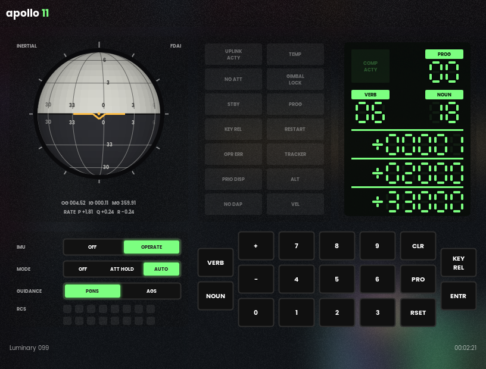

# the apollo 11 agc but in c++

## why the apollo 11 agc but in c++?

because I'm bored and I can recycle this as a college class project

## what it is

the software isn't rewritten: it's the original 1969 assembly, the code that flew (`Luminary099` for the lunar module, `Comanche055` for the command module). the c++ is everything it needs to run:

- the assembler that turns the source into a rope, word for word what MIT's YUL assembler made, checksums included
- the computer it runs on, a block ii agc
- the dsky you talk to it with
- the lunar module around it

so it's an emulator, not a port. the autopilot in the rope is what flies the lunar module: the jets it fires turn the vehicle, the imu measures it, it reads that back

## layout

- `agc/` - no ui
  - `yul::` - the assembler
  - `agc::c_computer` - the cpu, timers, interrupts, i/o channels, and the restart monitor (night watchman, rupt lock, tc trap) and standby
  - `agc::c_dsky` - the display and keyboard
  - `lm::` - the lunar module: imu (gimbals, cdus, coarse align, gyro torquing, pipas), 16 rcs jets, rigid body attitude, its orbit around the moon, the descent engine (throttle, trim gimbal), the landing radar's antenna and interface, the crew's switches and hand controller, apollo 11's pad load, and the start of the landing (the descent orbit, what the ground uplinked)
- `apollo11/` - the app: luminary 099 flying the lunar module, fdai ball and switches on the left, dsky on the right, drawn with [CelosUI](https://github.com/neear0/celosUI)
- `tools/agc_check/` - console tool: `assemble <MAIN.agc> --compare <rope>`, `run <MAIN.agc> "V16N65E"`, `land` (as run, from the descent orbit), `symbols`, `test`
- `Luminary099/`, `Comanche055/` - the 1969 source as Virtual AGC transcribed it, with a handful of transcription fixes so it assembles

## build

- visual studio 2022, x64
- clone [CelosUI](https://github.com/neear0/celosUI) next to this repo (`..\CelosUI`), or set `CelosUIDir`. built and tested with CelosUI `d297d47`
- open `apollo11.sln`, build, run

## test

- `agc_check test` from the repo root: both ropes against the 1969 ones (`tests/ropes`), the pad load against itself and the program, then luminary flying the lm: imu turn-on, V49, V48, hand flying, standby, and powered descent from P63's ignition to P64. about 10 seconds, exit code is the failures
- ci runs it on every push, without the ui (no CelosUI needed)

## try

- `V35E` - lamp test
- `V16N65E` - mission clock
- `V37E00E` - P00
- `RSET` - clear lights
- the imu turns on caged: 90 seconds with NO ATT lit, then the autopilot takes over
- `V37E00E` `V49E` `V25E` `+03000E` `+02000E` `+00000E` `PRO` `PRO` - automatic maneuver to those gimbal angles (30 and 20 degrees), watch the ball
- mode ATT HOLD and the arrows (pitch, roll) or `q` `e` (yaw) - fly it by hand, let go and it holds
- `V41N20E` and three angles - coarse align the imu, `V42E` and three angles - torque the gyros
- `V37E06E` then hold `PRO` - standby, hold it again to come back
- `V48E` then `PRO` `PRO` `PRO` - autopilot data (N46, N47), then the descent engine's trim (N48): its gimbal driven to the stop for a minute and back, V50N48 when done
- keyboard: digits, `v` `n` `+` `-` `c` `p` `r` `k`, enter

powered descent, headless for now: `agc_check land Luminary099/MAIN.agc "V37E63E{0661}P{5025}E{5018}P{0618}{5018}eE {9962}P MMMMMMMM?"` starts 8 minutes before ignition in apollo 11's descent orbit (47 by 8.4 nmi), selects P63, skips the fine align, lets R60 turn to the ignition attitude, arms the engine and gives the go at V99. `{vvnn}` waits for verb vv noun nn. the braking phase takes it to P64

## not simulated

the landing radar's data (it answers the computer without a lock, the ALT and VEL lights stay on, so navigation is the imu's alone and drifts by a couple of km), the ascent engine, the rendezvous radar, the aot, uplink. the moon is a point mass, the computer's lunar gravity isn't

the pad load is apollo 11's, from the grumman lm data book (`agc/src/lm/pad_load.cpp` says which table and what's left out). the computer powers on with erasable cleared, so the first fresh start is alarm 1107 (PROG lit), as on a real cold start. the state vectors, the landing site alignment and the clock are put where the ground's uplinks and the crew's alignment put them (`agc/src/lm/landing.cpp`)

comanche 055, the command module's program, assembles word for word but doesn't run: there's no command module

## credits

- the agc source: MIT instrumentation lab, 1969, public domain, transcribed by the [Virtual AGC](https://www.ibiblio.org/apollo/) project, via [chrislgarry/apollo-11](https://github.com/chrislgarry/apollo-11)
- yaYUL and yaAGC from Virtual AGC were the reference for how the assembler and cpu behave
