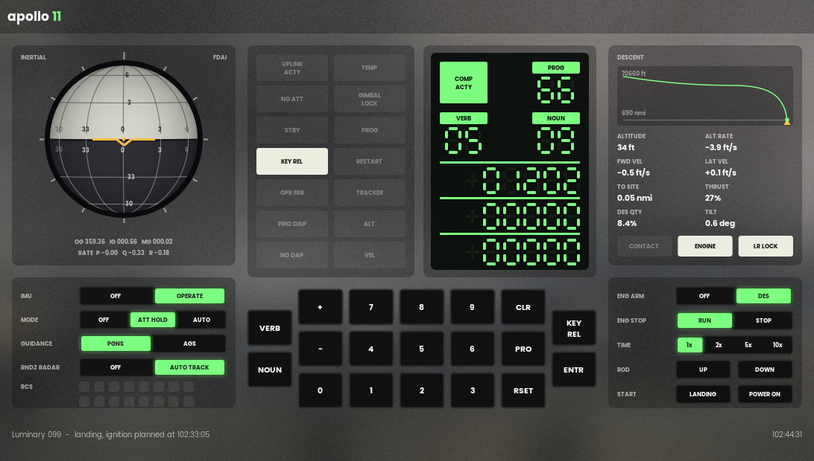
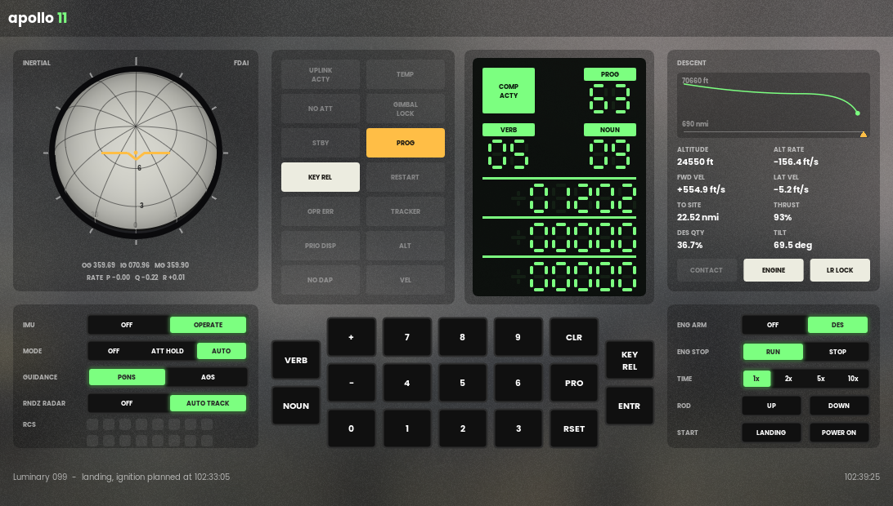

# the apollo 11 agc but in c++

## why the apollo 11 agc but in c++?

because I'm bored and I can recycle this as a college class project

## what it is

the software isn't rewritten: it's the original 1969 assembly, the code that flew (`Luminary099` for the lunar module, `Comanche055` for the command module). the c++ is everything it needs to run:

- the assembler that turns the source into a rope, word for word what MIT's YUL assembler made, checksums included
- the computer it runs on, a block ii agc
- the dsky you talk to it with
- the lunar module around it

so it's an emulator, not a port. the autopilot in the rope is what flies the lunar module: the jets it fires turn the vehicle, the imu measures it, it reads that back. and the landing programs in it land it: from apollo 11's descent orbit, P63, P64 and P65 bring it down on the landing site, 94 m off, at 0.9 m/s

## layout

- `agc/` - no ui
  - `yul::` - the assembler
  - `agc::c_computer` - the cpu, timers, interrupts, i/o channels, and the restart monitor (night watchman, rupt lock, tc trap) and standby
  - `agc::c_dsky` - the display and keyboard
  - `lm::` - the lunar module: imu (gimbals, cdus, coarse align, gyro torquing, pipas), 16 rcs jets, rigid body attitude, its orbit around the moon, the descent engine (throttle, trim gimbal), the landing radar (antenna, beams, the readings as the computer decodes them), the rendezvous radar's cdus (only those: what took the computer's time on apollo 11), the gear on the surface (contact light, touchdown), the crew's switches, hand controller and rate of descent switch, apollo 11's pad load, and the start of the landing (the descent orbit, what the ground uplinked)
- `apollo11/` - the app: luminary 099 flying the lunar module, fdai ball and switches on the left, dsky in the middle, the descent on the right (its profile, altitude, rates, thrust, propellant, the contact light, engine arm and stop, time warp), drawn with [CelosUI](https://github.com/neear0/celosUI)
- `tools/agc_check/` - console tool: `assemble <MAIN.agc> --compare <rope>`, `run <MAIN.agc> "V16N65E"`, `land` (as run, from the descent orbit), `symbols`, `test`
- `Luminary099/`, `Comanche055/` - the 1969 source as Virtual AGC transcribed it, with a handful of transcription fixes so it assembles

## build

- visual studio 2022, x64
- clone [CelosUI](https://github.com/neear0/celosUI) next to this repo (`..\CelosUI`), or set `CelosUIDir`. built and tested with CelosUI `d297d47`
- open `apollo11.sln`, build, run

## test

- `agc_check test` from the repo root: both ropes against the 1969 ones (`tests/ropes`), the pad load against itself and the program, then luminary flying the lm: imu turn-on, V49, V48, hand flying, standby, and the landing: P63's ignition, the landing radar's updates, P64, P65, the contact light, touchdown (how fast, how far from the site) and P68. then the same from 500 ft in P66, flown by a scripted crew on the hand controller and the rate of descent switch, and once more with the rendezvous radar on: V16N68 in P63, 1202, the software restart, and the landing anyway. about 12 seconds, exit code is the failures
- ci runs it on every push, without the ui (no CelosUI needed)

## try

- `V35E` - lamp test
- `V16N65E` - mission clock
- `V37E00E` - P00
- `RSET` - clear lights
- the imu turns on caged: 90 seconds with NO ATT lit, then the autopilot takes over
- `V37E00E` `V49E` `V25E` `+03000E` `+02000E` `+00000E` `PRO` `PRO` - automatic maneuver to those gimbal angles (30 and 20 degrees), watch the ball
- mode ATT HOLD and the arrows (pitch, roll) or `q` `e` (yaw) - fly it by hand, let go and it holds. the keys push the stick a third of the way, with shift all the way
- `V41N20E` and three angles - coarse align the imu, `V42E` and three angles - torque the gyros
- `V37E06E` then hold `PRO` - standby, hold it again to come back
- `V48E` then `PRO` `PRO` `PRO` - autopilot data (N46, N47), then the descent engine's trim (N48): its gimbal driven to the stop for a minute and back, V50N48 when done
- START `POWER ON` - start over, as switched on
- keyboard: digits, `v` `n` `+` `-` `c` `p` `r` `k`, enter for the dsky. the arrows, `q` `e` for the hand controller, `w` `s` for the rate of descent switch

the landing, in the app: START `LANDING` puts the lunar module in apollo 11's descent orbit, 8 minutes before ignition (47 by 8.4 nmi), the imu aligned and the uplink made. then, as the crew did:

- `RSET` (the fresh start's PROG light), `V37E63E` - P63
- `PRO` at V06N61, `ENTR` at V50N25 00014 (no fine align), `PRO` at V50N18: R60 turns it to the ignition attitude
- `ENTR` at the second V50N18, ENG ARM to `DES`, `PRO` at V99N62: ignition. be done well before ignition, or it's alarm 1703 and ignition slips (and the landing with it)
- once LR LOCK lights, `V57E` lets the landing radar's updates in. P64 at high gate, P65 to the surface
- ENG STOP when CONTACT lights, then `V37E68E`: P68, V06N43 shows where the computer thinks it landed

or land it yourself, as Armstrong did from about 500 ft: in P64 (or P65), MODE to `ATT HOLD` and a click of the ROD switch (`s`, or ROD `DOWN`) is P66. the computer holds the altitude rate it had, a foot a second faster with each click down (`s`) and slower with each click up (`w`), and the throttle is its. the attitude is yours: the arrows tilt the thrust to null FWD VEL and LAT VEL, TILT says how far over it is

1202, as on apollo 11: RNDZ RADAR to `AUTO TRACK` before P63, and `V16N68E` (delta h) once the landing radar is in. the radar's cdus run off an 800 hz that's frequency locked to the computer's but not in phase, so they count both its angles at 6400 a second each, and every count is a memory cycle the program doesn't get: about 15% of them. with the monitor on top the executive runs out of core sets, alarm 1202 (PROG, `V05N09E` shows it), and the software restarts: the guidance goes on where it was, the monitor is dropped (back to V06N63), and it lands. the flight had more of them (a second 1202 when Aldrin keyed V16N68 again, and 1201 and 1202 in P64); those don't come here

TIME runs it up to 10 times faster.

headless: `agc_check land Luminary099/MAIN.agc "V37E63E{0661}P{5025}E{5018}P{0618}{5018}eE {9962}P MMMMMWW V57E !   s WV37E68E{0643}W?"` is the same landing typed in: `{vvnn}` waits for verb vv noun nn, `e` arms the engine, `!` waits for the contact light, `s` is engine stop, `h` attitude hold and `u` `d` the rate of descent switch. the landing radar locks on at about 34000 ft, V16N68 shows delta h settling after V57E

## not simulated

the moon is a smooth sphere through the landing site (no terrain, no craters for the landing radar), and a point mass, where the computer's lunar gravity isn't (its navigation is some 40 m off by ignition from that). the gear just stops the vehicle, it doesn't bounce or tip. the ascent engine, the rendezvous radar (but its cdus' counting), the aot, uplink

the pad load is apollo 11's, from the grumman lm data book (`agc/src/lm/pad_load.cpp` says which table and what's left out). the computer powers on with erasable cleared, so the first fresh start is alarm 1107 (PROG lit), as on a real cold start. the state vectors, the landing site alignment, the clock and the landing time are put where the ground's uplinks and the crew's alignment put them (`agc/src/lm/landing.cpp`). the landing time is moved so ignition comes at 102:33:05, as flown: the prelaunch pad load's would put it two hours early, at 100:39

comanche 055, the command module's program, assembles word for word but doesn't run: there's no command module

## credits

- the agc source: MIT instrumentation lab, 1969, public domain, transcribed by the [Virtual AGC](https://www.ibiblio.org/apollo/) project, via [chrislgarry/apollo-11](https://github.com/chrislgarry/apollo-11)
- yaYUL and yaAGC from Virtual AGC were the reference for how the assembler and cpu behave

## license

the c++ is MIT (`LICENSE`). `Luminary099/` and `Comanche055/` are the MIT instrumentation lab's, public domain
